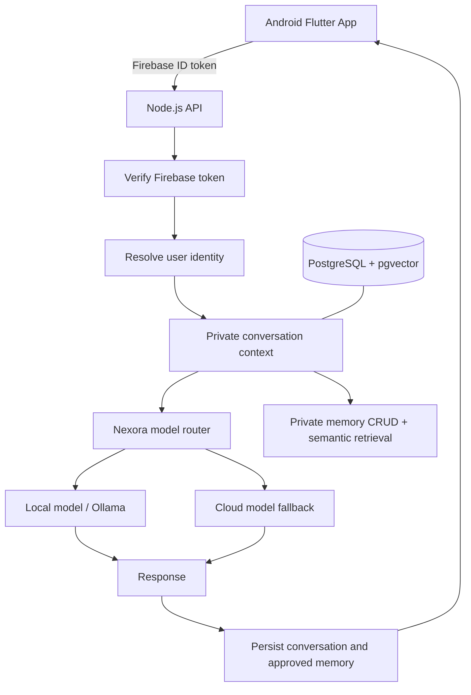

# AISYAH Android / Nexora — Architecture

## Identity contract

- Aisyah: assistant persona, user-facing identity, tone, and interaction rules.
- Nexora: AI model/system, inference routing, orchestration, and retrieval.
- Project AISYAH: long-term integration into a physical humanoid platform.
- The running ChatGPT model is not renamed by this project; Nexora is a separately
  developed system.

## Request flow

## Data boundaries

1. Firebase UID is the external identity; backend maps it to an internal user UUID.
2. Conversation, message, and private-memory rows are user-scoped.
3. Private RAG is never automatically promoted to shared knowledge. Phase 3 memories are explicitly user-curated.
4. Shared knowledge requires review and explicit approval.
5. Model weights are not changed from ordinary chat messages.
6. Fine-tuning is a separate, scheduled, evaluated workflow with human approval.
7. Secrets remain in deployment secret storage, never in source control or app binaries.

## Runtime

- Android is the first client.
- Node.js backend orchestrates auth, retrieval, and model routing.
- Local inference is preferred when configured and compatible.
- Cloud inference is a fallback, not an assumed always-on dependency.
- The backend must return a controlled error if no provider is available.

## Phase 4 governance path

`explicit opt-in chat phrase → pending memory_proposals → user approval → private_memories`

`user shared-knowledge submission → pending knowledge_submissions → allowlisted reviewer → shared_knowledge + knowledge_review_audit`

These paths are separate. Personal memory is never promoted into shared knowledge automatically.
